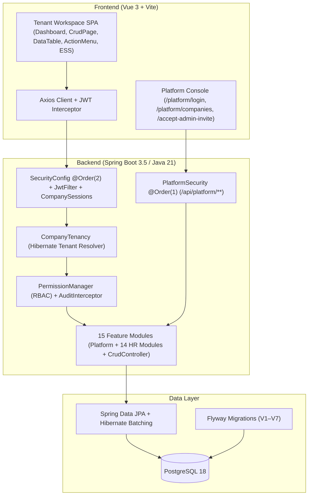

# HRMS — Enterprise Multi-Tenant Human Resource Management System

A full-stack, modular, multi-tenant **Human Resource Management System (HRMS)** built with **Java 21**, **Spring Boot 3.5**, **PostgreSQL 18**, and **Vue 3 (Vite)**. Designed with an executive Linear/Stripe-inspired SaaS interface, company-scoped multi-tenancy, a dedicated Platform Owner Console for tenant onboarding, revocable JWT sessions, granular Role-Based Access Control (RBAC), centralized sticky-header data tables, and end-to-end server-side pagination across all modules.

---

## Highlights

- **Complete Employee Lifecycle:** Organization hierarchy, employee directory, recruitment/ATS with one-click hiring, attendance tracking, leave approvals, payroll runs with printable payslips, expense claims & advances, and performance appraisals.
- **Multi-Tenant SaaS & Platform Onboarding:**
  - Schema-level company isolation (`tenant_id`) enforced via Hibernate `CurrentTenantIdentifierResolver` (`CompanyTenancy`) and database constraints/triggers.
  - Dedicated **Platform Owner Console** (`/platform/login`, `/platform/companies`) to create, edit, suspend, and reactivate companies, view platform KPIs & audit events, and issue 48-hour one-time company admin setup invitations (`/accept-admin-invite`).
  - Dual isolated Spring Security filter chains: `PlatformSecurity` (`@Order(1)`) for `/api/platform/**` with its own Base64 JWT signing key, brute-force lockout (5 failures -> 5-minute lock), 20-minute sessions, and 5-minute fresh-auth window for sensitive mutations; and `SecurityConfig` (`@Order(2)`) for tenant APIs with server-backed revocable `company_session` JWTs.
- **Executive SaaS UI & Centralized Table System:**
  - Deep Obsidian (`#09090B`) static-header sidebar, Alabaster (`#FAFAFA`) canvas, pure white KPI cards with tinted icon badges, semantic status colors (Emerald / Amber / Rose), and Chart.js analytics.
  - Single-source-of-truth table theme ([table-theme.css](frontend/src/styles/table-theme.css)) paired with reusable [DataTable.vue](frontend/src/shared/components/DataTable.vue) (sticky headers, client-side column sorting, row selection, loading/empty states), [PaginationBar.vue](frontend/src/shared/components/PaginationBar.vue) (`10 / 20 / 50 / 100` rows per page), and [ActionMenu.vue](frontend/src/shared/components/ActionMenu.vue) (teleported three-dot row action popover with semantic stroke icons, frosted surface, direction-aware animations, and full keyboard navigation).
- **Database Performance & Migrations:**
  - Flyway-managed PostgreSQL schema across 7 versioned migrations (`V1`–`V7`), including comprehensive B-tree & composite indexes (`V2__add_indexes.sql`).
  - Hibernate batch fetching (`default_batch_fetch_size: 50`, `jdbc.batch_size: 50`) to eliminate N+1 queries.
  - Server-side database pagination (`?page=0&size=20`) across all list endpoints.
- **Security & Compliance:** Company-scoped login (`companyCode` + username or email), BCrypt password hashing, fine-grained `{module}:{action}` RBAC permissions, and immutable audit logs (`audit_log` for tenants and `platform_audit_event` for platform operations).

---

## Tech Stack

| Layer | Technology |
| :--- | :--- |
| **Backend** | Java 21, Spring Boot 3.5.6, Spring Security, Spring Data JPA (Hibernate 6), Spring Mail, Validation, Lombok |
| **Authentication & Tenancy** | JJWT 0.12.6 + BCrypt, revocable PostgreSQL sessions (`company_session`, `platform_sessions`), Hibernate multi-tenant resolver |
| **Database & Migrations** | PostgreSQL 18, Flyway (`V1__init.sql` – `V7__local_platform_auth.sql`) |
| **Frontend** | Vue 3.5.13 (Composition API), Vue Router 4.5, Vite 6.0, Axios 1.7, Chart.js 4.4 |
| **Build Tools** | Apache Maven 3.9+ (wrapper `backend/mvn.cmd` included), Node.js 20+ / npm |

---

## Architecture Overview



---

## Modules

| Module | Capabilities |
| :--- | :--- |
| **Platform & Multi-Tenancy** | Platform owner sign-in, tenant KPI dashboard & recent platform activity, paginated/filterable company directory, create/edit/suspend/reactivate companies, and 48-hour one-time admin onboarding invitations (send, resend, revoke, accept). |
| **Dashboard** | Executive KPI cards (headcount, 12-month attrition, pending leaves/expenses, open positions, pipeline) and Chart.js visualizations (department headcount, today's attendance, joiners vs. leavers, leave trend, gender split, monthly net payroll, upcoming birthdays). |
| **Core HR & Organization** | Branches, departments, designations, and full employee records (employment type, reporting manager, holiday list, banking details). |
| **Leave** | Leave types, yearly allocations, leave applications with approve/reject/cancel workflows, holiday calendars, and balance calculations. |
| **Attendance** | Shift types, daily attendance records, self-service check-in/check-out, automatic working-hours calculation, and monthly summaries. |
| **Payroll** | Salary components (earnings/deductions), salary structures, employee assignments, monthly payroll runs, draft recalculation, final submission, and printable salary slips. |
| **Recruitment (ATS)** | Job openings, applicant tracking, interview scheduling and ratings, and one-click conversion from applicant to employee. |
| **Expenses** | Expense categories, multi-line expense claims with approve/reject/pay workflows, and employee advances. |
| **Performance** | Appraisal cycles, weighted employee goals with progress tracking, self & manager ratings, and automated final score calculation (70% manager rating + 30% weighted goal achievement). |
| **Self-Service (ESS)** | Dedicated employee workspace (`/my/**`) for profile, daily punch-in/out, leave requests & balances, attendance log, expense claims, goals, appraisals, and submitted payslips. |
| **Administration & Audit** | User management, custom roles with granular permissions, in-app & optional SMTP email notifications, and immutable tenant audit logs. |

---

## Multi-Tenancy & Platform Onboarding

### Tenant Authentication & Isolation
- Every company has a unique case-insensitive `code` (e.g. `initial` for the default migrated workspace) and lifecycle status (`PENDING`, `ACTIVE`, `SUSPENDED`).
- Tenant users sign in at `/login` using **Company code**, **Email or username**, and **Password**.
- Signing in creates a server-tracked row in `company_session` linked to a signed JWT; logging out (`POST /api/auth/logout`) or suspending a company immediately invalidates active sessions.
- All tenant-owned tables carry `tenant_id`, automatically bound per request via `CompanyTenancy`.

### Platform Owner Console
When `app.platform.enabled=true` and `app.tenancy.allow-additional-companies=true`:
1. **Bootstrap the initial platform owner (`logavasu`):** Point `app.platform.bootstrap-password-file` (or env var `HRMS_PLATFORM_PASSWORD_FILE`) to a single-line file containing a password (12–72 UTF-8 bytes). On first startup, `PlatformAuth` hashes and inserts the owner into `platform_users` if absent.
2. **Manage companies:** Sign in at `http://localhost:5173/platform/login` to access `/platform/companies`, create new companies, edit company details (name, code, contact email, timezone, currency), suspend/reactivate tenants, and manage onboarding invites.
3. **Admin invitation acceptance:** Creating a company generates a 48-hour one-time invitation link (`<public-origin>/accept-admin-invite#<token>`) delivered via SMTP (when configured). Accepting the invite sets the initial company admin password (12–72 characters), activates the company, and redirects to `/login?company=<code>`.

---

## Database Migrations (Flyway)

Flyway runs automatically on backend startup against PostgreSQL 18 (`backend/src/main/resources/db/migration/`):

| Migration | Purpose |
| :--- | :--- |
| [V1__init.sql](backend/src/main/resources/db/migration/V1__init.sql) | Core HRMS schema across all 14 modules |
| [V2__add_indexes.sql](backend/src/main/resources/db/migration/V2__add_indexes.sql) | B-tree and composite indexes for foreign keys, filters, and sort orders |
| [V3__add_company_ownership.sql](backend/src/main/resources/db/migration/V3__add_company_ownership.sql) | Introduces `company` table and `tenant_id` ownership columns |
| [V4__company_sessions.sql](backend/src/main/resources/db/migration/V4__company_sessions.sql) | Adds `company_session` table and automatic session revocation triggers |
| [V5__require_company_scope.sql](backend/src/main/resources/db/migration/V5__require_company_scope.sql) | Enforces strict `tenant_id` scoping and `role_permission` tenant triggers |
| [V6__platform_onboarding.sql](backend/src/main/resources/db/migration/V6__platform_onboarding.sql) | Adds company timezone/currency, `company_admin_invitation`, and `platform_audit_event` |
| [V7__local_platform_auth.sql](backend/src/main/resources/db/migration/V7__local_platform_auth.sql) | Adds `platform_users` (with lockout tracking) and `platform_sessions` |

---

## Prerequisites

- **JDK 21+** ([Eclipse Adoptium](https://adoptium.net))
- **Apache Maven 3.9+** (or use the included `backend/mvn.cmd` wrapper on Windows)
- **Node.js 20+** and **npm**
- **PostgreSQL 18** running on `localhost:5433` with a database named `hrms`

---

## Configuration

Local secrets and feature flags live in `backend/application-local.properties` (excluded from Git via `.gitignore` and imported automatically by `application.yml`):

```properties
# Database & Tenant Auth
DB_PASSWORD=your_postgres_password
JWT_SECRET=a_random_secret_string_at_least_32_characters_long
ADMIN_INITIAL_PASSWORD=your_initial_admin_password

# Optional: Enable SMTP email notifications & admin onboarding emails
# app.mail.enabled=true
# app.mail.from=hr@example.com
# spring.mail.host=smtp.example.com
# spring.mail.port=587
# spring.mail.username=
# spring.mail.password=
# spring.mail.properties.mail.smtp.auth=true
# spring.mail.properties.mail.smtp.starttls.enable=true

# Optional: Enable Platform Owner Console & Multi-Company Onboarding
app.platform.enabled=true
app.tenancy.allow-additional-companies=true
app.platform.public-origin=https://localhost:5173
# Must be valid Base64 decoding to >= 32 bytes and different from JWT_SECRET
app.platform.jwt-secret=your_base64_encoded_32_byte_platform_secret
# Optional path to a single-line file (>= 12 chars) to bootstrap initial platform owner
app.platform.bootstrap-password-file=${HRMS_PLATFORM_PASSWORD_FILE:}
```

Database connection, Flyway, and Hibernate batching settings are defined in [application.yml](backend/src/main/resources/application.yml), with production overrides (including secure session cookie defaults) in [application-prod.yml](backend/src/main/resources/application-prod.yml).

---

## Running the Application

### Option 1: Windows Batch Scripts (Project Root)

Open two terminals in the project root:

```powershell
# Terminal 1 — Backend (http://localhost:8080)
.\run-backend.bat

# Terminal 2 — Frontend (http://localhost:5173)
.\run-frontend.bat
```

### Option 2: Manual Commands

**Terminal 1 — Backend** (Flyway automatically applies migrations on startup):
```powershell
cd backend
.\mvn.cmd spring-boot:run
```

**Terminal 2 — Frontend:**
```powershell
cd frontend
npm install
npm run dev
```

Open:
- **Tenant Workspace:** [http://localhost:5173](http://localhost:5173)
- **Platform Owner Console:** [http://localhost:5173/platform/login](http://localhost:5173/platform/login)

---

## API Overview & Pagination

### Key Authentication & Platform Endpoints
- `POST /api/auth/login` — Tenant sign-in (`companyCode`, `username`, `password`)
- `POST /api/auth/logout` — Revoke current tenant session
- `GET /api/auth/me` & `POST /api/auth/change-password` — Active user info & password update
- `POST /api/auth/accept-admin-invite` — Activate a new company via 48-hour invite token
- `POST /api/platform/auth/login`, `GET /api/platform/session`, `POST /api/platform/logout` — Platform owner auth
- `GET /api/platform/dashboard`, `GET/POST /api/platform/companies`, `GET/PUT /api/platform/companies/{id}` — Platform company management
- `POST /api/platform/companies/{id}/suspend|reactivate` & `/invitation/resend|revoke` — Tenant lifecycle & invite actions

### Server-Side Pagination
All tenant list endpoints support server-side pagination via `page` (0-indexed) and `size` (default `20`, max `200`):

```http
GET /api/core/employees?page=0&size=20
```

**Response format (`PageResponse<T>`):**
```json
{
  "content": [ ... ],
  "page": 0,
  "size": 20,
  "totalElements": 142,
  "totalPages": 8,
  "first": true,
  "last": false
}
```

Omitting the `page` query parameter returns the raw array for lightweight form dropdown lookups.

---

## Roles & Permissions

Every protected tenant endpoint follows `/api/{module}/...` and enforces `{module}:{action}` permissions via `PermissionManager`:

- `read` — View module screens and records
- `write` — Create, edit, and delete records
- `approve` — Approve, reject, pay, or submit workflows (`leave`, `expense`, `payroll`, `performance`)
- `{module}:*` — All actions within a module
- `*` — Full company administrative access

Self-service endpoints (`/api/me/**`) require only an authenticated tenant user linked to an employee record. Platform endpoints (`/api/platform/**`) require a valid Platform Owner bearer token and are denied on the tenant filter chain.

---

## Testing & Production Build

```powershell
# Run Backend Tests (includes PlatformOnboardingTest & SQL tenancy checks)
cd backend
.\mvn.cmd test

# Build Backend JAR
.\mvn.cmd clean package -DskipTests

# Build Frontend Static Bundle (outputs to frontend/dist/)
cd ..\frontend
npm run build
```

---

## Project Structure

```text
hr/
├── README.md
├── run-backend.bat
├── run-frontend.bat
├── backend/
│   ├── pom.xml
│   ├── mvn.cmd
│   ├── application-local.properties     # Local secrets & flags (gitignored)
│   └── src/
│       ├── main/
│       │   ├── java/com/hrms/
│       │   │   ├── HrmsApplication.java
│       │   │   ├── modules/
│       │   │   └── shared/
│       │   └── resources/
│       │       ├── application.yml
│       │       ├── application-prod.yml
│       │       └── db/migration/
│       └── test/
│           ├── java/com/hrms/platform/
│           └── resources/sql/
└── frontend/
    ├── index.html
    ├── package.json
    ├── vite.config.js
    ├── public/
    │   └── logo.jpg                     # Brand logo & favicon
    └── src/
        ├── App.vue
        ├── main.js
        ├── style.css                    # Executive SaaS color tokens & layout styles
        ├── styles/
        │   └── table-theme.css          # Centralized table, sticky-header & ActionMenu theme
        ├── router/                      # Dynamic route registration & guards
        ├── modules/                     # Feature modules (pages / models / services / routes)
        │   ├── admin/
        │   ├── attendance/
        │   ├── auth/
        │   ├── dashboard/
        │   ├── employee/
        │   ├── expense/
        │   ├── leave/
        │   ├── notifications/
        │   ├── payroll/
        │   ├── performance/
        │   ├── platform/                # OwnerLogin.vue, Companies.vue, AcceptInvite.vue
        │   ├── recruitment/
        │   └── selfservice/
        └── shared/
            ├── api.js                   # Axios client & JWT interceptor
            ├── auth.js                  # Session & permission helpers
            ├── utils.js                 # Formatting utilities
            ├── modelHelpers.js
            └── components/
                ├── Layout.vue           # Static-logo obsidian sidebar + top bar
                ├── CrudPage.vue         # Generic paginated CRUD view & modal form
                ├── DataTable.vue        # Reusable sortable/selectable sticky-header table
                ├── ActionMenu.vue       # Teleported row action popover with semantic icons & keyboard nav
                ├── PaginationBar.vue    # Reusable pagination controls
                ├── FieldInput.vue
                └── SlipModal.vue        # Printable payslip modal
```
