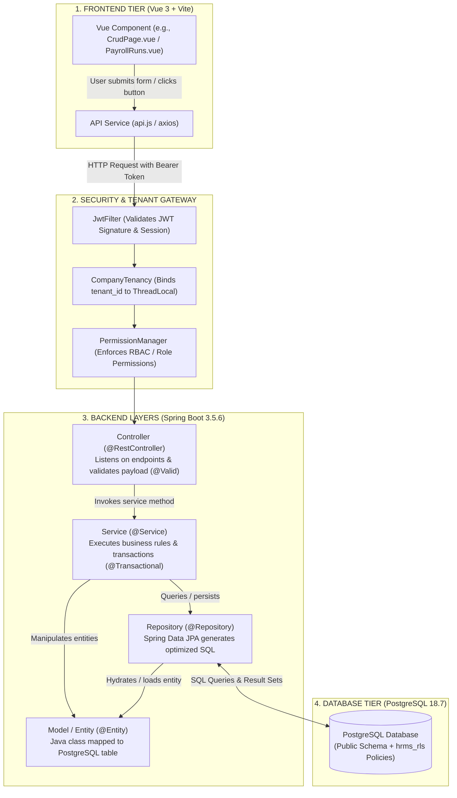
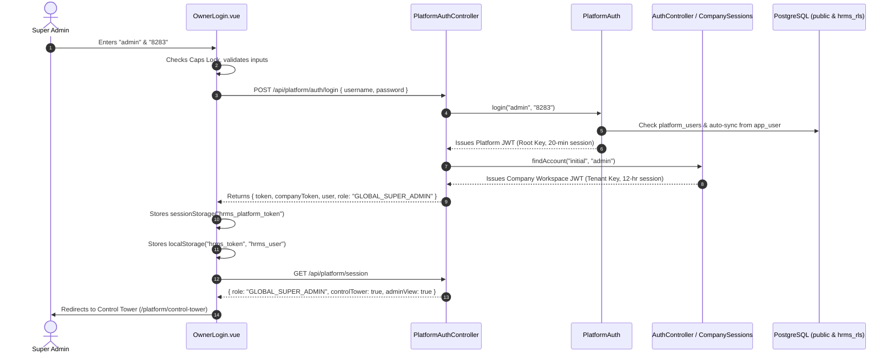

# Enterprise Multi-Tenant Human Resource Management System (HRMS)

> A full-stack, enterprise-grade **Multi-Tenant HRMS & Platform Control Plane** built with **Java 21**, **Spring Boot 3.5.6**, **PostgreSQL 18.7**, and **Vue 3.5 (Vite 6)**.  
> Features dual-token zero-lockout authentication, PostgreSQL Row-Level Security (RLS), a global Control Tower, and end-to-end employee lifecycle automation.

---

## 1. System Overview & Dual-Plane Capabilities

The platform operates on a **Dual-Plane Architecture**:

| Plane | Access Route | Target Audience | Core Capabilities |
| :--- | :--- | :--- | :--- |
| **Global Platform Control Plane** | `/platform/*` | Platform Super Admins | Control Tower, tenant registry & onboarding, company status toggles, platform RBAC, immutable security audit logs, and one-click workspace jump. |
| **Company Workspace Plane** | `/*` | HR, Managers, Employees | Employee directory, attendance & shifts, leave management, automated batch payroll, recruitment ATS, expenses, and performance appraisals. |
| **Admin View (Cross-Tenant)** | Topbar Pill `🏢` | Super Admins | Seamlessly inspect and manage any tenant's workspace screens on the fly without logging out or losing platform credentials. |

---

## 2. Request-Response Architecture Flow (Controller ➔ Service ➔ Model)

When a user interacts with the application, the request travels through a strict multi-tier pipeline:



### Layer Responsibilities

1. **Frontend View (`.vue`) & API Service (`api.js`):** Collects form data, attaches the Bearer JWT token, and sends HTTP requests via Axios.
2. **Security & Tenancy Gateway (`JwtFilter`, `CompanyTenancy`, `PermissionManager`):** Decodes the token, verifies session activity in `company_session`, binds `tenant_id` to thread-local storage, and checks permission tuples (e.g. `employee:write` or `*`).
3. **Controller Layer (`@RestController`):** Handles URL mappings (`GET`, `POST`, `PUT`, `DELETE`), performs `@Valid` input checks, and delegates directly to the Service layer.
4. **Service Layer (`@Service`):** Contains business logic (e.g., payroll calculations, leave balance deductions, tax rules) wrapped in transactional boundaries (`@Transactional`).
5. **Repository Layer (`@Repository`):** Uses Spring Data JPA to generate type-safe SQL queries without hand-written SQL strings.
6. **Model / Entity Layer (`@Entity`):** Represents database tables as annotated Java classes (`@Table`, `@Id`, `@ManyToOne`).
7. **Database (PostgreSQL 18.7):** Persists records across 39 relational tables and enforces Row-Level Security (RLS) constraints.

---

## 3. Super Admin Authentication & Capabilities

### A. Dual-Token Login Flow (`/platform/login`)



### B. What a Super Admin Can Do

| Domain | Screen / Route | Super Admin Capabilities |
| :--- | :--- | :--- |
| **Global Control Tower** | `/platform/control-tower` | Monitor system-wide KPIs, joiner/leaver counts, cross-tenant attendance rates, and leave trends with year/month filters. |
| **Tenant Registry** | `/platform/companies` | Create new companies, suspend/reactivate tenants, issue 48-hour onboarding invitation links, and trigger one-click workspace jumps. |
| **One-Click Workspace Jump** | Button in Companies list | Immediately opens any selected company's workspace (`/dashboard`, `/employees`, `/attendance`, etc.) without separate credentials. |
| **Security & Access** | `/platform/access` | Manage platform administration roles (`GLOBAL_SUPER_ADMIN`, `SECURITY_ADMINISTRATOR`). |
| **Security Audit Trail** | `/platform/audit` | Search immutable server-wide security events (actor IPs, timestamps, HTTP status codes, endpoints). |
| **Full Workspace Authority** | Company Sidebar | Full unrestricted `*` permissions across all HR modules: onboard employees, approve leaves, run batch payroll, post jobs, and view encrypted bank accounts. |
| **Instant Company Switcher** | Topbar Pill (`🏢`) | Switch between companies on the fly without logging out. |

---

## 4. Technology Stack & Scale

| Layer | Technology | Specification / Version |
| :--- | :--- | :--- |
| **Backend Language** | Java | **Java 21 (LTS)** |
| **Framework** | Spring Boot | **v3.5.6** (Web, Security, Data JPA, Validation, Mail) |
| **Database Engine** | PostgreSQL | **PostgreSQL 18.7** with Row-Level Security (RLS) |
| **Database Migrations**| Flyway | **7 Migrations** (`V1__init.sql` through `V7__local_platform_auth.sql`) |
| **Security & Auth** | JJWT & Spring Security | **Dual HMAC-SHA256 JWTs**, BCrypt password hashing |
| **Frontend Framework** | Vue 3 | **v3.5.13** (Composition API, `<script setup>`) |
| **Bundler & Tooling** | Vite | **v6.4.6** |
| **Routing & Client** | Vue Router & Axios | **Vue Router 4.5**, Axios 1.7 |
| **Charts & Styling** | Chart.js & Design System | **Chart.js 4.4**, Custom Obsidian & Alabaster Design System |

### Codebase Scale
* **123 Java Source Files** in `backend/src/` (configured with `<sourceDirectory>src</sourceDirectory>`).
* **31 Vue Single-File Components** in `frontend/src/`.
* **39 Relational Tables** in PostgreSQL.
* **50+ Authenticated REST Endpoints**.

---

## 5. Complete Database Schema Catalog (39 Tables)

The database schema is managed via 7 Flyway migrations (`V1__init.sql` through `V7__local_platform_auth.sql`):

### Tenancy & Platform Core
1. **`company`**: Organization registry (`id`, `name`, `code`, `status`, `timezone`, `currency`, `created_at`).
2. **`company_session`**: Active revocable tenant sessions (`id`, `tenant_id`, `user_id`, `expires_at`).
3. **`company_admin_invitation`**: 48-hour onboarding invitation tokens (`id`, `tenant_id`, `email`, `secret_hash`, `expires_at`).
4. **`platform_users`**: Root platform operators (`id`, `username`, `password_hash`, `active`, `failures`, `locked_until`).
5. **`platform_sessions`**: Root platform sessions (`id`, `user_id`, `expires_at`, `finance_verified_at`).
6. **`platform_audit_event`**: Platform security audit log (`id`, `actor`, `action`, `tenant_id`, `request_path`, `http_status`).

### Identity & Administration
7. **`app_user`**: Company users (`id`, `tenant_id`, `username`, `email`, `password_hash`, `role_id`, `employee_id`, `active`).
8. **`role`**: Authorization roles (`id`, `tenant_id`, `name`, `description`).
9. **`role_permission`**: Permission tuples (`id`, `tenant_id`, `role_id`, `permission`).
10. **`audit_log`**: Workspace transactional audit log (`id`, `tenant_id`, `actor`, `action`, `method`, `path`, `status`).
11. **`notification`**: User notification queue (`id`, `tenant_id`, `user_id`, `title`, `body`, `read`).

### Core HR & Hierarchy
12. **`branch`**: Physical branches (`id`, `tenant_id`, `name`, `code`, `address`, `city`, `country`).
13. **`department`**: Departments with parent hierarchy (`id`, `tenant_id`, `name`, `code`, `parent_department_id`).
14. **`designation`**: Position titles (`id`, `tenant_id`, `name`, `description`).
15. **`employee`**: Comprehensive employee profiles (`id`, `tenant_id`, `employee_code`, `first_name`, `last_name`, `email`, `phone`, `date_of_joining`, `employment_status`, `department_id`, `designation_id`, `branch_id`, `reports_to_id`, `bank_name`, `bank_account_no`, `bank_routing_no`).

### Attendance, Shifts & Leaves
16. **`shift_type`**: Shift hours and grace period parameters (`id`, `tenant_id`, `name`, `start_time`, `end_time`, `grace_period_mins`).
17. **`attendance`**: Daily check-in/out logs (`id`, `tenant_id`, `employee_id`, `attendance_date`, `check_in`, `check_out`, `status`, `worked_hours`).
18. **`leave_type`**: Leave categories (`id`, `tenant_id`, `name`, `is_paid`, `max_days_per_year`).
19. **`leave_allocation`**: Annual quotas (`id`, `tenant_id`, `employee_id`, `leave_type_id`, `year`, `total_leaves`, `used_leaves`).
20. **`leave_application`**: Leave bookings and approval status (`id`, `tenant_id`, `employee_id`, `leave_type_id`, `start_date`, `end_date`, `status`, `approver_id`).
21. **`holiday_list`** & 22. **`holiday`**: Statutory and company holiday calendars.

### Payroll & Compensation
23. **`salary_component`**: Allowance and deduction definitions (`id`, `tenant_id`, `name`, `type`, `is_taxable`).
24. **`salary_structure`** & 25. **`salary_structure_line`**: Component formulas and salary templates.
26. **`salary_assignment`**: Employee base salary contracts (`id`, `tenant_id`, `employee_id`, `salary_structure_id`, `base_salary`, `effective_from`).
27. **`payroll_run`**: Batch monthly runs (`id`, `tenant_id`, `period_year`, `period_month`, `status`, `total_gross`, `total_deductions`, `total_net`).
28. **`salary_slip`** & 29. **`salary_slip_line`**: Itemized pay stubs published to employees.

### Recruitment, Expenses & Performance
30. **`job_opening`**: Requisitions and vacancy descriptions.
31. **`job_applicant`**: Candidate pipeline and resumes.
32. **`interview`**: Interview schedules and scoring.
33. **`expense_type`**: Expense categories (Travel, Lodging, Office).
34. **`expense_claim`** & 35. **`expense_claim_line`**: Reimbursement claims.
36. **`employee_advance`**: Salary advances and installment deductions.
37. **`appraisal_cycle`**: Performance review periods.
38. **`goal`**: Employee OKR objectives and completion rates.
39. **`appraisal`**: Self and manager review scorecards (70% manager rating + 30% goal achievement).

---

## 6. Project Directory Structure

```
hr/
├── backend/
│   ├── mvn.cmd                                # Windows Maven wrapper
│   ├── pom.xml                                # Spring Boot dependencies & build config
│   ├── application-local.properties           # Local DB credentials & JWT secret keys
│   └── src/
│       ├── app/
│       │   └── HrmsApplication.java           # Spring Boot main launcher
│       ├── modules/
│       │   ├── admin/                         # Users, roles, permissions, company
│       │   ├── attendance/                    # Attendance records, shifts, summary
│       │   ├── audit/                         # Audit interceptors & logs
│       │   ├── auth/                          # Workspace auth & company switcher
│       │   ├── dashboard/                     # KPI analytics
│       │   ├── employee/                      # Employees, org hierarchy, bank details
│       │   ├── expense/                       # Claims, advances
│       │   ├── leave/                         # Leave types, allocations, requests
│       │   ├── notifications/                 # In-app notifications
│       │   ├── payroll/                       # Structures, runs, slips, tax
│       │   ├── performance/                   # Cycles, goals, appraisals
│       │   ├── platform/                      # Control tower, registry, platform auth
│       │   ├── recruitment/                   # Jobs, applicants, interviews
│       │   └── selfservice/                   # Employee personal space
│       ├── shared/
│       │   ├── common/                        # ApiException, global handler, CrudController
│       │   ├── config/                        # Isolation guards, web configuration
│       │   ├── security/                      # Dual JWT, CompanySessions, FinanceControls
│       │   └── tenancy/                       # TenantDatabaseScope, CompanyTenancy
│       └── resources/
│           ├── application.yml                # Default Spring configuration
│           └── db/migration/                  # Flyway SQL migrations (V1 to V7)
│
└── frontend/
    ├── package.json                           # Dependencies (Vue 3, Vite, Axios, Chart.js)
    ├── vite.config.js                         # Vite dev & proxy config
    ├── index.html                             # Single Page Application entry
    ├── public/                                # Static branding (logo.jpg)
    └── src/
        ├── App.vue                            # Root router view
        ├── style.css                          # Design system variables & utilities
        ├── router/index.js                    # Route registrations & auth guards
        ├── shared/                            # Global components, auth.js, api.js
        └── modules/                           # Feature modules (admin, auth, attendance,
                                               # dashboard, employee, leave, payroll, platform)
```

---

## 7. Setup & Run Instructions

### Prerequisites
* **Java:** JDK 21 (Eclipse Temurin, OpenJDK, or GraalVM)
* **Node.js:** v20.x or v22.x with npm 10+
* **Database:** PostgreSQL 18 running on port `5432` with database `hrms`

### Credentials Reference

| Portal | URL | Inputs | Access Level |
| :--- | :--- | :--- | :--- |
| **Super Admin Platform Console** | `http://localhost:5173/platform/login` | **Username:** `admin`<br>**Password:** `8283` | Root Platform, Control Tower, Cross-Company Workspace access. |
| **Standard Company Workspace** | `http://localhost:5173/login` | **Company Code:** `initial`<br>**Username:** `admin`<br>**Password:** `8283` | Primary Company Workspace (Employees, Attendance, Payroll, Leave, etc.). |

### Step-by-Step Execution

#### 1. Start the Backend
In a terminal, navigate to `backend` and run:

```powershell
cd d:\myv1\hr\backend
.\mvn.cmd spring-boot:run
```
*Backend runs on: `http://localhost:8080`*

#### 2. Start the Frontend
In a second terminal, navigate to `frontend` and run:

```powershell
cd d:\myv1\hr\frontend
npm run dev
```
*Frontend runs on: `http://localhost:5173`*

---

## 8. Build Verification

Both the frontend and backend have been built and verified with zero errors:

```powershell
# Verify frontend production build
npm --prefix frontend run build
# Result: 186 modules transformed, built in 4.25s (0 errors)

# Verify backend compilation
.\backend\mvn.cmd -f backend\pom.xml compile
# Result: BUILD SUCCESS in 3.44s (0 errors)
```
