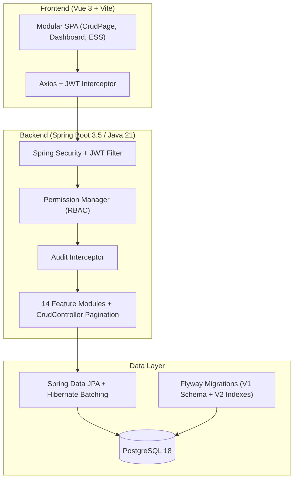

# HRMS — Enterprise Human Resource Management System

A full-stack, modular **Human Resource Management System (HRMS)** built with **Java 21**, **Spring Boot 3.5**, **PostgreSQL 18**, and **Vue 3 (Vite)**. Designed with an executive Linear/Stripe-inspired SaaS interface, stateless JWT security, granular Role-Based Access Control (RBAC), database indexing, and end-to-end server-side pagination across all modules.

---

## Highlights

- **Complete Employee Lifecycle:** Organization hierarchy, employee directory, recruitment/ATS with one-click hiring, attendance tracking, leave approvals, payroll runs with printable payslips, expense claims, and performance appraisals.
- **Executive SaaS UI:** Deep Obsidian (`#09090B`) static-header sidebar, Alabaster (`#FAFAFA`) canvas, pure white KPI cards with tinted icon badges, semantic status colors (Emerald / Amber / Rose), and unified Electric Indigo & Crisp Cyan Chart.js analytics.
- **Database Performance & Pagination:**
  - Flyway-managed PostgreSQL schema ([V1__init.sql](backend/src/resources/db/migration/V1__init.sql)) and comprehensive B-tree & composite indexes ([V2__add_indexes.sql](backend/src/resources/db/migration/V2__add_indexes.sql)).
  - Hibernate batch fetching (`default_batch_fetch_size: 50`, `jdbc.batch_size: 50`) to eliminate N+1 queries.
  - Server-side database pagination (`?page=0&size=20`) across all modules with a reusable frontend pagination bar (`10 / 20 / 50 / 100` rows per page).
- **Security & Compliance:** Stateless JWT authentication, fine-grained `{module}:{action}` permissions, and an automated request audit log (`audit_log`).

---

## Tech Stack

| Layer | Technology |
| :--- | :--- |
| **Backend** | Java 21, Spring Boot 3.5.6, Spring Security, Spring Data JPA (Hibernate 6), Spring Mail, Validation, Lombok |
| **Authentication** | JWT (`io.jsonwebtoken` JJWT 0.12.6) + BCrypt password hashing |
| **Database & Migrations** | PostgreSQL 18, Flyway (`V1__init.sql`, `V2__add_indexes.sql`) |
| **Frontend** | Vue 3.5 (Composition API), Vue Router 4.5, Vite 6, Axios 1.7, Chart.js 4.4 |
| **Build Tools** | Apache Maven 3.9+, Node.js 20+ / npm |

---

## Architecture Overview



---

## Modules

| Module | Capabilities |
| :--- | :--- |
| **Dashboard** | Executive KPI cards (headcount, 12-month attrition, pending leaves/expenses, open positions, pipeline) and Chart.js visualizations (department headcount, today's attendance, joiners vs. leavers, leave trend, gender split, monthly net payroll, upcoming birthdays). |
| **Core HR & Organization** | Branches, departments, designations, and full employee records (employment type, reporting manager, holiday list, banking details). |
| **Leave** | Leave types, yearly allocations, leave applications with approve/reject/cancel workflows, holiday calendars, and balance calculations. |
| **Attendance** | Shift types, daily attendance records, self-service check-in/check-out, automatic working-hours calculation, and monthly summaries. |
| **Payroll** | Salary components (earnings/deductions), salary structures, employee assignments, monthly payroll runs, draft recalculation, final submission, and printable salary slips. |
| **Recruitment (ATS)** | Job openings, applicant tracking, interview scheduling and ratings, and one-click conversion from applicant to employee. |
| **Expenses** | Expense categories, multi-line expense claims with approve/reject/pay workflows, and employee advances. |
| **Performance** | Appraisal cycles, weighted employee goals with progress tracking, self & manager ratings, and automated final score calculation (70% manager rating + 30% weighted goal achievement). |
| **Self-Service (ESS)** | Dedicated employee workspace for profile, daily punch-in/out, leave requests & balances, attendance log, expense claims, goals, appraisals, and submitted payslips. |
| **Administration & Audit** | User management, custom roles with granular permissions, in-app & optional SMTP email notifications, and immutable audit logs. |

---

## Prerequisites

- **JDK 21+** ([Eclipse Adoptium](https://adoptium.net))
- **Apache Maven 3.9+** (or use the included `backend/mvn.cmd` wrapper script on Windows)
- **Node.js 20+** and **npm**
- **PostgreSQL 18** running on `localhost:5433` with a database named `hrms`

---

## Configuration

Local secrets live in `backend/application-local.properties` (excluded from Git via `.gitignore`):

```properties
DB_PASSWORD=your_postgres_password
JWT_SECRET=a_random_secret_string_at_least_32_characters_long
ADMIN_INITIAL_PASSWORD=your_initial_admin_password

# Optional: Enable SMTP email notifications
# app.mail.enabled=true
# app.mail.from=hr@example.com
# spring.mail.host=smtp.example.com
# spring.mail.port=587
# spring.mail.username=
# spring.mail.password=
# spring.mail.properties.mail.smtp.auth=true
# spring.mail.properties.mail.smtp.starttls.enable=true
```

Database connection and Hibernate settings are defined in `backend/src/resources/application.yml` (and `application-prod.yml` for production deployments).

---

## Running the Application

### Option 1: Windows Batch Scripts (Project Root)

Open two terminals in the project root:

```powershell
# Terminal 1 — Backend (http://localhost:8080)
.\run-backend.bat

# Terminal 2 — Frontend (http://localhost:5173)
.\run-frontend.bat
```

### Option 2: Manual Commands

**Terminal 1 — Backend** (Flyway automatically creates tables and indexes on startup):
```powershell
cd backend
.\mvn.cmd spring-boot:run
```

**Terminal 2 — Frontend:**
```powershell
cd frontend
npm install
npm run dev
```

Open **[http://localhost:5173](http://localhost:5173)** in your browser.

---

## Pagination API

All list endpoints support server-side database pagination via `page` (0-indexed) and `size` (default `20`, max `200`):

```http
GET /api/core/employees?page=0&size=20
```

**Response format (`PageResponse<T>`):**
```json
{
  "content": [ ... ],
  "page": 0,
  "size": 20,
  "totalElements": 142,
  "totalPages": 8,
  "first": true,
  "last": false
}
```

Omitting the `page` query parameter returns the raw array for lightweight form dropdown lookups.

---

## Roles & Permissions

Every protected endpoint follows `/api/{module}/...` and enforces `{module}:{action}` permissions via `PermissionManager`:

- `read` — View module screens and records
- `write` — Create, edit, and delete records
- `approve` — Approve, reject, pay, or submit workflows (`leave`, `expense`, `payroll`, `performance`)
- `{module}:*` — All actions within a module
- `*` — Full administrative access

Self-service endpoints (`/api/me/**`) require only an authenticated user linked to an employee record.

---

## Production Build

```powershell
# Build Backend JAR
cd backend
.\mvn.cmd clean package -DskipTests

# Build Frontend Static Bundle (outputs to frontend/dist/)
cd frontend
npm run build
```

---

## Project Structure

```text
hr/
├── README.md
├── run-backend.bat
├── run-frontend.bat
├── backend/
│   ├── pom.xml
│   ├── mvn.cmd
│   ├── application-local.properties     # Local secrets (gitignored)
│   └── src/
│       ├── app/
│       │   └── HrmsApplication.java     # Spring Boot entry point
│       ├── modules/                     # Feature modules (controller / model / repository / service)
│       │   ├── admin/
│       │   ├── attendance/
│       │   ├── audit/
│       │   ├── auth/
│       │   ├── dashboard/
│       │   ├── employee/
│       │   ├── expense/
│       │   ├── leave/
│       │   ├── notification/
│       │   ├── organization/
│       │   ├── payroll/
│       │   ├── performance/
│       │   ├── recruitment/
│       │   └── selfservice/
│       ├── shared/
│       │   ├── common/                  # BaseEntity, CrudController, PageResponse, ApiException, GlobalExceptionHandler
│       │   ├── config/                  # WebConfig
│       │   └── security/                # SecurityConfig, JwtFilter, JwtService, PermissionManager, CurrentUser
│       └── resources/
│           ├── application.yml
│           ├── application-prod.yml
│           └── db/migration/
│               ├── V1__init.sql         # Core schema
│               └── V2__add_indexes.sql  # Performance indexes across all modules
└── frontend/
    ├── index.html
    ├── package.json
    ├── vite.config.js
    ├── public/
    │   └── logo.jpg                     # Brand logo & favicon
    └── src/
        ├── App.vue
        ├── main.js
        ├── style.css                    # Executive SaaS color tokens & layout styles
        ├── router/                      # Dynamic route registration
        ├── modules/                     # Feature modules (pages / models / services / routes)
        └── shared/
            ├── api.js                   # Axios client & JWT interceptor
            ├── auth.js                  # Session & permission helpers
            ├── utils.js                 # Formatting utilities
            ├── modelHelpers.js
            └── components/
                ├── Layout.vue           # Static-logo obsidian sidebar + top bar
                ├── CrudPage.vue         # Generic paginated CRUD table & modal form
                ├── PaginationBar.vue    # Reusable pagination controls
                ├── FieldInput.vue
                └── SlipModal.vue        # Printable payslip modal
```
